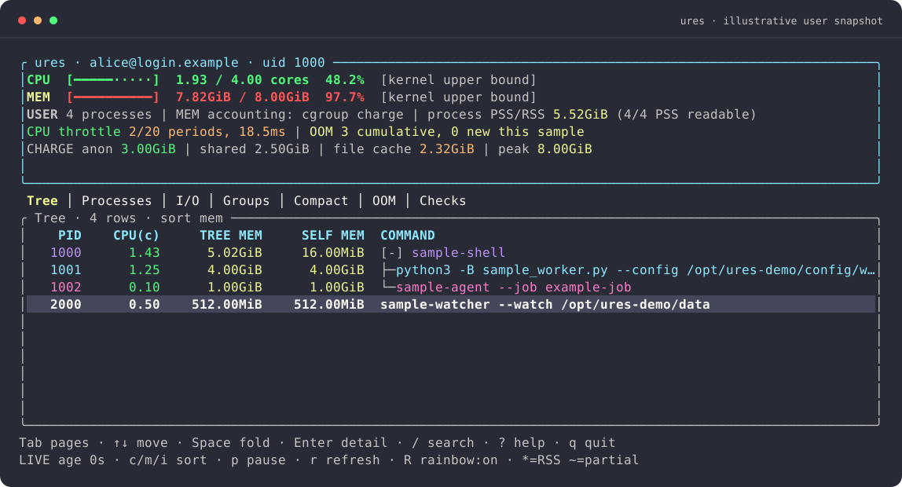

<div align="center">

# ures

### Follow the user. Find the process tree.


**English** · [简体中文](README.zh-CN.md)



<sub>Interactive dashboard with sample data.</sub>

</div>

`ures` shows **which processes, process trees, and applications are consuming a Linux user's resources**. Its interactive dashboard combines CPU and memory usage, quota pressure, I/O and OOM history. Use `report` for text or JSON output and `-i` for repeated snapshots.

| Find out | Command |
| --- | --- |
| Open the interactive dashboard | `ures` |
| Print the trees using the most memory | `ures report --view tree` |
| Which process uses CPU? | `ures report --view ps --sort cpu` |
| What is another user running? | `ures -u alice` |
| Which application is responsible? | `ures report --view groups` |
| Is it doing I/O or holding many FDs? | `ures report --view io` |
| Was something OOM-killed? | `ures report --view oom --since 24h` |
| Explore a configured view | `ures --view io` |

## Get started

```bash
ures                           # Open the TUI
ures --theme light -i2          # Light TUI, refreshed every two seconds
ures report                    # Print the overview and default view once
ures --view io -i2             # Explore I/O interactively
ures report --view tree --pid 12345 --full    # Focus a subtree; retain complete commands
ures report --view ps --sort mem -n10         # Single-process memory ranking
ures report --json             # A versioned machine-readable snapshot
ures report -i2 --json --count 3 # Three NDJSON snapshots
ures -h                        # Main commands and common options
ures report --help             # All report options, grouped by purpose
ures config path               # Find your configuration
ures config themes             # List built-in themes
```

`--view NAME` selects a configured view; omitting it uses `default_view`.
Use `ures` in an interactive terminal, or `ures report` in a pipe or script.
See the [command reference](docs/cli.md) for the full interface.

Use `-h` for brief help or `--help` for all options at the current command/action.
Press `?` inside the TUI for key bindings.

CPU usage is displayed in cores; memory uses PSS where available. Metric units,
coverage markers and accounting scopes are described in the
[metric and snapshot reference](docs/snapshots.md).

## Install and develop

Download a [release archive](https://github.com/flymin/ures/releases) for
`x86_64-unknown-linux-musl` or `aarch64-unknown-linux-musl`, verify `SHA256SUMS`,
then place `ures` on your `PATH`. The static executable needs Linux `/proc`
and no Python or Rust runtime. Cgroup and kernel-log data depend on access permissions.

Build with an existing **Rust 1.99.0** toolchain, rustfmt, Clippy and the matching musl target:

```bash
git clone https://github.com/flymin/ures.git
cd ures
./build.sh

# Standard Cargo workflows are supported too:
cargo test --locked
cargo run -- --help
```

`build.sh` runs the checks and writes the static executable to
`target/<target>/release/ures`. Set `URES_INSTALL_DIR` to install it to a
directory of your choice.
See [CONTRIBUTING.md](CONTRIBUTING.md) for build and test details.

## Make the view yours

The first run creates a commented TOML configuration at
`${XDG_CONFIG_HOME}/ures/config.toml`, or `~/.config/ures/config.toml` by default.
Use `ures config path` to locate it.

```bash
ures config show               # Effective configuration, including selected profile
ures config check              # Validate all profiles without executing checks
ures --view compact
ures --profile lab
ures --config ./team.toml
```

Partial configuration is enough. Maps merge by property; arrays replace. Runtime options override the selected profile, then global values, then built-ins.

```toml
# auto | manual | auto-or-manual
[limits]
mode = "auto"

# Explicitly select this budget with --profile lab.
[profiles.lab.limits]
mode = "manual"
cpu_cores = 4.0
memory = "8GiB"

[views.tree]
columns = ["pid", "cpu", "mem", "self_mem", "threads", "command"]
sort = "mem"
top = 15

[[groups]]
name = "Workers"
match = 'sample_worker\.py|sample-watcher'
```

Manual values are **configured budgets**, not kernel settings. Detected kernel bounds remain available independently. `auto-or-manual` uses a budget only when the corresponding user limit cannot be detected; plain `auto` does not silently use configured numbers.

Views choose `tree`, `ps`, `groups`, `oom` or `checks`, an optional display `name`, fields, sort, row count, and optional `include`/`exclude` regexes. An explicit `[views]` selects the available tabs; builtin view keys retain omitted field defaults. Profiles patch/add to that selection. Tree filtering retains ancestor context; inclusive totals still include hidden descendants. Ordered application rules use first-match wins, followed by executable-name grouping. Columns can change titles, widths and hiding priority. Themes support Ratatui color names, RGB hex colors and indexed colors. See the [view reference](docs/views.md), [complete template](config/default.toml) and [profile examples](examples/profiles.toml).

## Interactive mode

`ures` creates one tab for every resolved `views` entry. A top-level
`tab_order` array controls their order; unlisted views follow in key order.
The default template orders Tree, Processes, I/O, Groups, Compact, OOM, Checks.
Use `tab_order = []` for alphabetical order. `name` supplies the label; without
it the key is displayed. `default_view`
selects the initial tab, overridden by `--view`. Each view honors `top` (`0` for
all rows); `--top` overrides it across tabs. Switching tabs restores each view's
sort, search, folded branches, selection and scroll position. Long tab lists
scroll to keep the selected tab visible.

For example, this configuration creates exactly three tabs:

```toml
default_view = "workers"
tab_order = ["workers", "events", "health"]
[views.workers]
name = "Workers"
kind = "tree"
columns = ["pid", "cpu", "mem", "command"]
top = 0
[views.events]
name = "OOM history"
kind = "oom"
[views.health]
kind = "checks"
```

Column widths and hiding priorities are configurable. The command column fills
the available space, and long values are truncated to fit the terminal.

Three built-in themes are available: Dracula, Alucard light and Gruvbox.
CPU, memory and I/O have distinct colors; optional rainbow colors identify processes.
`NO_COLOR` and `--color never` disable colors. For example:

```toml
[columns.read]
width = 12
[columns.write]
width = 12
[theme]
name = "dracula"
rainbow = true
# Optional explicit overrides:
# cpu = "#50fa7b"
# selection_bg = "#44475a"
```

Use `ures --theme light` for Alucard Classic (ivory background), or
`ures --theme gruvbox` for warm Gruvbox colors. Persist the choice with
`[theme] name = "light"` (on separate lines). `--theme` overrides the selected
name; explicitly configured colors still override the palette. `foreground` and
`background` can be `"reset"` to inherit terminal defaults.

Profiles are user-defined patches of **all global settings**, including limits,
views, checks, intervals and theme settings. Select one with `--profile work`
or top-level `default_profile = "work"`. Built-in themes do not create profiles.
For example, `[profiles.work.theme] name = "gruvbox"` can accompany a work
profile's other overrides. `ures --profile work --theme light` retains those
other overrides while selecting the light palette. See the
[theme and profile reference](docs/themes.md).

| Key | Action |
| --- | --- |
| Tab / Shift-Tab | Switch pages |
| ↑↓ / j k | Select and scroll |
| PageUp / PageDown | Jump ten rows |
| Home / End | First / last row |
| Space / ← / → | Fold or unfold a tree |
| Enter | Complete process details |
| c / m / i | Sort CPU / memory / logical I/O |
| / | Search current view content; Enter applies, Esc clears |
| p / r | Pause the display / request a fresh sample |
| R (Shift-r) | Toggle rainbow row colors for this session |
| ? / q / Esc | Help / exit; any key closes help or details |

## Extend the checks

An external command returns a versioned JSON object containing status, summary and numeric metrics. No plugin runtime or dynamic library ABI is required.

```toml
[checks.zombies]
enabled = true
command = ["python3", "/path/to/ures/examples/check-zombies.py"]
interval_seconds = 10.0
timeout_seconds = 2.0
```

Commands are argument arrays, with no implicit shell. The runner supplies `URES_TARGET_USER`, `URES_TARGET_UID` and `URES_CONTEXT`. At most two commands run concurrently; each has a deadline and 64 KiB output bounds. Failed, stale or malformed results remain local to that check. Only configured, enabled extensions execute.

See the [check protocol](docs/extensions.md), [JSON Schema](docs/check.schema.json) and [snapshot format](docs/snapshots.md). CLI snapshots and TUI cards use the same check results.

## Contribute and release

See [CONTRIBUTING.md](CONTRIBUTING.md) for development and testing, and
[architecture](docs/architecture.md) for the module layout.

Tagged releases provide static Linux x86_64/aarch64 archives, SHA256 checksums
and third-party license notices. [CHANGELOG](CHANGELOG.md) · [MIT license](LICENSE).
